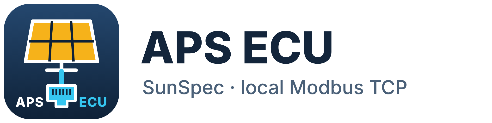
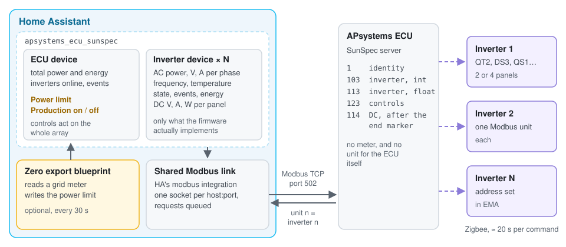
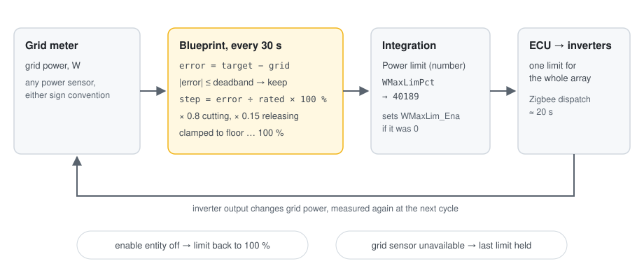
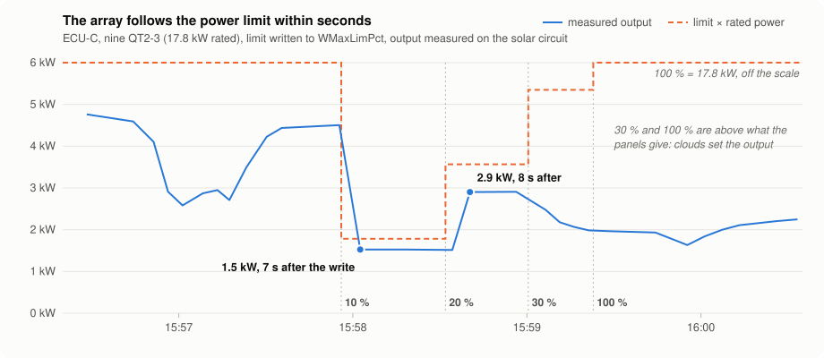

<p align="center">
  <picture>
    <source media="(prefers-color-scheme: dark)" srcset="custom_components/apsystems_ecu_sunspec/brand/dark_logo@2x.png">
    
  </picture>
</p>

# apsystems-ecu-sunspec-modbus

[](https://github.com/bdecl/apsystems-ecu-sunspec-modbus/releases)
[](https://hacs.xyz)
[](https://github.com/bdecl/apsystems-ecu-sunspec-modbus/actions/workflows/validate.yml)
[](https://www.home-assistant.io)
[](https://analytics.home-assistant.io/)
[](LICENSE)

A Home Assistant integration for the **APsystems ECU**, talking to the ECU's own
SunSpec server over Modbus TCP: no cloud, nothing installed on the ECU. It reads
every inverter down to each panel, and exposes the array's power limit and
on/off switch, with a zero export blueprint to drive them.

It is built on a register map of the ECU-C measured register by register, which is
published here too, with the scripts used to obtain it.

## Quick start

1. **On the ECU**, in EMA Manager: ECU app, Workspace, *Modbus Configuration*. Set
   *Switch* to On and give every inverter a Modbus address.
2. **Install** through HACS, then restart Home Assistant (2026.10 or newer).

   [](https://my.home-assistant.io/redirect/hacs_repository/?owner=bdecl&repository=apsystems-ecu-sunspec-modbus&category=integration)
3. **Add the integration** and enter the ECU's IP address. It scans the inverters
   and shows what it found before creating anything.

   [](https://my.home-assistant.io/redirect/config_flow_start/?domain=apsystems_ecu_sunspec)
4. **Optional:** import the zero export blueprint, and paste one of the
   [ready-made dashboards](homeassistant/dashboards/).

   [](https://my.home-assistant.io/redirect/blueprint_import/?blueprint_url=https%3A%2F%2Fraw.githubusercontent.com%2Fbdecl%2Fapsystems-ecu-sunspec-modbus%2Fmain%2Fblueprints%2Fautomation%2Fapsystems_ecu_sunspec%2Fzero_export.yaml)

## How it fits together



The ECU serves one Modbus unit per inverter on port 502. The integration reads
them all through Home Assistant's shared Modbus connection and creates one device
per inverter, plus one device for the ECU with the array totals and the controls.
The controls act on the whole array: the ECU passes them on to every inverter over
Zigbee, which takes about 20 seconds.

## Compatibility

| | Status | Notes |
|---|---|---|
| **ECU-C** (ID `215…`) | ✅ Tested | Firmware `ECU-C-Z_C1.2.26`. APsystems lists Modbus from firmware C1.1.3 |
| **ECU-R** (ID `2160…`) | ⚠️ Expected, untested | APsystems lists Modbus from firmware 1.3.7 |
| **ECU-R Pro** (ID `2162…`) | ⚠️ Expected, untested | APsystems lists Modbus from firmware 2.0.2 |
| **ECU-B** (ID `2163…`) | ❌ Not possible | APsystems disables Modbus on this model |
| **QT2** (three-phase, 4 panels) | ✅ Tested | Nine QT2-3 on an ECU-C |
| **DS3**, DS3-L, DS3-H (single-phase, 2 panels) | ⚠️ Simulator only | Single-phase models are decoded and tested against a simulated ECU |
| **QS1**, YC600, YC1000 | ⚠️ Expected, untested | Panel count known from the model name |
| Modbus RTU (RS485) | ❌ Not supported | TCP only |
| [bolkedebruin/apsystems-sunspec](https://github.com/bolkedebruin/apsystems-sunspec) adapter (port 1502) | ❌ Not yet | Detected and refused with a clear message |
| Home Assistant | 2026.10 or newer | Needed for the shared Modbus connection |

If you run it on hardware marked ⚠️, an issue saying whether it works, with the
integration's diagnostics attached, is very welcome.

## Home Assistant integration

### Install

HACS, three dots, Custom repositories, add this repository as an *Integration*,
then install **APsystems ECU SunSpec (Modbus)** and restart Home Assistant. Or copy
`custom_components/apsystems_ecu_sunspec` into your configuration folder.

Home Assistant 2026.10 or newer is required. The integration takes its Modbus
connection from Home Assistant's own `modbus` integration rather than opening its
own socket: every integration that addresses the same host and port shares one
connection, and their requests queue instead of competing. A second Modbus client
has been reported to make an ECU stop answering, so that matters. A `modbus:`
hub declared in YAML still opens a separate connection: do not point one at the
ECU while the integration is in use.

Then Settings, Devices & services, Add integration, *APsystems ECU SunSpec*. Enter
the ECU's address. The integration scans the Modbus addresses and shows what it
found before creating anything:

- the inverters that answer, at whatever addresses you gave them in EMA, gaps
  included;
- their model and AC topology, single-, split- or three-phase (models 101/102/103
  and 111/112/113), per inverter, so a mixed fleet works;
- the out-of-chain DC block, and how many DC channels each inverter has;
- which controls of model 123 actually work.

If you add inverters later, use *Reconfigure* on the integration to scan again.

### What you get

One device for the array, one per inverter. Inverters are named after their model
and the last 5 digits of their serial number, for example *QT2-3 (12345)*, so the names stay
unique with several ECUs and do not depend on the Modbus addresses set in EMA.

| Device | Entities |
|---|---|
| APsystems ECU | Total AC power, total energy, total DC power, inverters producing and online, active events, **power limit** (number), **production** and **power limit enabled** (switches) |
| APsystems inverter *n* | AC power, current and voltages per phase, frequency, energy, temperature, operating state, events, DC voltage, current and power per channel |

Points the firmware does not implement are not created. Each inverter is read
from the integer model (it carries state and events, and its energy counter keeps
full precision), with the float model filling any point the integer one leaves
empty.

The controls act on **the whole array**, whichever inverter address they are
written through, and are therefore on the ECU device, not on the inverters.
Setting a power limit also sets `WMaxLim_Ena` if it was off, since a limit is
otherwise stored and silently ignored. The integration does not run a control
loop itself: that is what the blueprint is for.

### Zero export blueprint





A real test on the ECU-C: the limit stepped to 10, 20, 30 and back to 100 %.
Production followed within 7 to 8 seconds; a larger step on another day took
about 20 seconds, hence the 30-second control period.

[](https://my.home-assistant.io/redirect/blueprint_import/?blueprint_url=https%3A%2F%2Fraw.githubusercontent.com%2Fbdecl%2Fapsystems-ecu-sunspec-modbus%2Fmain%2Fblueprints%2Fautomation%2Fapsystems_ecu_sunspec%2Fzero_export.yaml)

Or, in Home Assistant: Settings, Automations & scenes, Blueprints, Import
blueprint, and paste the raw file address:

```
https://raw.githubusercontent.com/bdecl/apsystems-ecu-sunspec-modbus/main/blueprints/automation/apsystems_ecu_sunspec/zero_export.yaml
```

Inputs: a grid power sensor (either sign convention), the power limit entity,
the array's rated power, a target grid power, a deadband, separate gains for
cutting and releasing, a floor, the control period and an optional enable entity
(a tariff or battery-full condition, for instance). It is incremental, holds the
last limit when the grid measurement disappears, and puts the array back to
100 % when the enable entity turns off. Keep the period at 30 s or more: dispatch
to the inverters takes about 20 s.

### Dashboards

[homeassistant/dashboards/](homeassistant/dashboards/) has a three-phase and a
single-phase dashboard built from native cards only. Paste one into a dashboard's
raw configuration editor and copy the per-inverter blocks for each of your
inverters.

### ECU ID

The ECU itself is not visible over Modbus, so the setup form has an optional
**ECU ID** field: the 12 digits on the ECU label or in EMA. With it, the ECU
device is named after its model and the end of its ID, for example
*ECU-C (1234)*, and shows its model and serial number. The prefix gives the model,
after APsystems' SunSpec Modbus document: `215` ECU-C, `2160` ECU-R,
`2162` ECU-R Pro. It can also be added later with *Reconfigure*.

On a new installation with an ECU ID, the ECU entities are named after the device
(`sensor.ecu_c_1234_power`) instead of `sensor.apsystems_ecu_power`: adapt the
example dashboards. With two ECUs this is what keeps them apart. Adding the ID to
an existing entry renames the device, not the entities.

### Night and sleeping inverters

When the inverters stop at dusk, the ECU goes on answering with the values of its
last round: a few watts, the grid voltage and frequency, operating state *MPPT*.
No register says that the data is old. During the day the ECU refreshes it about
every 5 minutes and the measurements change at nearly every round, so an inverter
whose measurements have not changed for 15 minutes is shown as asleep: power and
currents 0, voltage, frequency and temperature unknown, operating state
*Sleeping*. Energy counters keep their value. It wakes up with the first new data
in the morning. *Inverters online* and *Inverters producing* count only inverters
with fresh data, and each inverter has a *Last data update* sensor.

After a restart at night the old values show for those first 15 minutes, until
the integration has seen that they do not move.

### Limits

- The ECU itself is not visible over Modbus: no ECU serial, no ECU model, and its
  CT clamps cannot be read. A grid meter has to come from elsewhere.
- The [bolkedebruin/apsystems-sunspec](https://github.com/bolkedebruin/apsystems-sunspec)
  adapter (port 1502, installed on the ECU) is detected but not supported yet.
- Tested against an ECU-C with QT2 inverters and against a simulator built from
  the register map. Reports from other ECUs and inverters are welcome.

## FAQ and troubleshooting

<details>
<summary><b>The power limit does nothing</b></summary>

In order of likelihood:

- **The ECU is linked to an APsystems ELT battery in EMA.** The ECU then accepts
  the limit, reads it back correctly and never applies it, without any error.
  Remove the link in EMA. Details in [docs/elt-link-issue.md](docs/elt-link-issue.md).
- **The limit is above what the array is producing.** A limit of 50 % changes
  nothing at 30 % of rated power. Test with a value well below current production.
- **It has not had time yet.** The ECU passes the limit on over Zigbee in about
  20 seconds. Judge by measured AC power, not by the value read back: the ECU
  echoes what was written whether it applies it or not.

The integration sets `WMaxLim_Ena` itself when needed. If you write the registers
yourself, 40193 must be 1, or the limit is stored and ignored.

</details>

<details>
<summary><b>Setup says there is no answer</b></summary>

- SunSpec must be switched on in EMA (*Modbus Configuration*, *Switch* On), and
  port 502 is fixed.
- The ECU-B has no Modbus at all.
- Another Modbus client pointed at the ECU can make it stop answering. Remove any
  `modbus:` hub declared in YAML for the ECU: the integration shares Home
  Assistant's connection with other integrations, but a YAML hub opens its own.

</details>

<details>
<summary><b>Some inverters are missing</b></summary>

Every inverter needs a Modbus address in EMA, and the scan stops at *Highest
Modbus address to scan*. Raise it if your addresses go higher. After adding
inverters or changing addresses in EMA, use *Reconfigure* on the integration to
scan again.

</details>

<details>
<summary><b>At night the inverters show 0 W and Sleeping</b></summary>

That is expected. The ECU keeps serving the last values it received after the
inverters stop, so the integration marks an inverter as asleep when its data has
not changed for 15 minutes. See [Night and sleeping inverters](#night-and-sleeping-inverters).

</details>

<details>
<summary><b>Can I limit or stop a single inverter?</b></summary>

Not over Modbus. The ECU applies model 123 to the whole array, whichever inverter
address it is written through. That is why the controls are on the ECU device and
not on the inverters.

</details>

<details>
<summary><b>How do I switch the array off?</b></summary>

With the **Production** switch on the ECU device. The power limit is not an off
switch: even at its lowest setting it lets a small share of rated power through.

</details>

<details>
<summary><b>The limit keeps jumping up and down</b></summary>

Make sure only one thing writes the limit: a second automation, an older YAML
controller or another Home Assistant instance pointed at the same ECU will fight
the blueprint. If the blueprint alone oscillates, lower *Gain when cutting* or
lengthen *Control period*.

</details>

<details>
<summary><b>The Installs badge shows an error</b></summary>

The count comes from Home Assistant's public usage analytics. It appears once
installations with *Usage analytics* turned on have reported the integration,
which takes a day or two after the first ones.

</details>

## Register map and findings

Everything below was measured on a real installation, not taken from a datasheet.
APsystems publishes a short "SunSpec Modbus" document that lists a handful of
example reads; it does not say which fields are implemented, and it describes at
least one block that is not where the specification says it should be.

### Key findings

**The immediate controls are global, not per-inverter.** Model 123 is read and
written through an individual inverter's unit id, but the ECU applies the command
to the whole array. Writing `Conn = 0` on unit 1 stops every inverter. Writing
`WMaxLimPct = 1 %` on unit 1 curtails the entire installation to 1 % of its rated
power. Every other model is genuinely per-inverter. Confirmed on several unit ids.

**Model 123 is nearly empty.** Of its twenty-four registers, three carry real
commands: `Conn`, `WMaxLimPct` and `WMaxLim_Ena`. No power-factor control, no VAr
control, and none of the window, revert or ramp timing registers are implemented.
Nothing reverts on its own — if your controller stops, the last limit written
stays in force indefinitely.

**There is an undocumented model after the end of the chain.** The SunSpec chain
terminates at register 40210. A model 114 header sits at 40212, with 48 registers
of per-channel DC data behind it. A conforming client that walks the chain will
never see it; it is reachable only by hard-coded address.

**The float model loses status.** `St` and `Evt1` are implemented in model 103
(integer) and unimplemented in model 113 (float). A client that picks the float
model for precision silently loses operating state and event reporting.

**The ECU has no meter on Modbus.** Unit ids 0 to 247 were scanned: only the
configured inverter addresses answer. There is no SunSpec meter model, no reserved
unit for the gateway, and nothing in the out-of-chain block that reports grid
power. The ECU-C's own CT clamps are not reachable over Modbus by any route.

**A silent failure mode breaks zero export entirely.** While the ECU is linked to
an APsystems ELT storage system in EMA, it accepts power-limit writes, echoes the
value back correctly, reports the enable flag as set, and never applies the limit.
No error is returned at any layer, and `Conn` keeps working normally, which makes
it look like anything but a suppressed command. See
[docs/elt-link-issue.md](docs/elt-link-issue.md).

### Tested on

ECU-C, firmware `ECU-C-Z_C1.2.26`, nine QT2-3 three-phase microinverters, Modbus
TCP on port 502. Identifiers in the documentation are masked.

Other ECU models and firmware versions are likely to differ. If you run the probe
scripts on different hardware, a pull request with your output is welcome — that
is the point of this repository.

### Contents

| Path | What it is |
|---|---|
| [docs/register-map.md](docs/register-map.md) | Every register, its type, a measured value and whether the firmware implements it |
| [docs/elt-link-issue.md](docs/elt-link-issue.md) | The silent curtailment failure: symptoms, evidence, diagnosis and fix |
| [docs/official-documentation.md](docs/official-documentation.md) | What the manufacturer's reference covers, where it differs from the device, and links |
| [scripts/sunspec_walk.py](scripts/sunspec_walk.py) | Walks the model chain and prints what the ECU exposes. Start here |
| [scripts/sunspec_dump.py](scripts/sunspec_dump.py) | Full register-by-register dump, emits a markdown table |
| [scripts/ecu_probe.py](scripts/ecu_probe.py) | Scans unit ids and sweeps the address space for undocumented content |
| [custom_components/apsystems_ecu_sunspec](custom_components/apsystems_ecu_sunspec) | Home Assistant integration, installable through HACS |
| [blueprints/automation/apsystems_ecu_sunspec/zero_export.yaml](blueprints/automation/apsystems_ecu_sunspec/zero_export.yaml) | Zero export blueprint for the integration |
| [homeassistant/dashboards/](homeassistant/dashboards/) | Ready-made dashboards, three-phase and single-phase |
| [homeassistant/modbus.yaml](homeassistant/modbus.yaml) | YAML alternative: Modbus hub and sensors, documented and ready to adapt |
| [homeassistant/zero_export_example.yaml](homeassistant/zero_export_example.yaml) | YAML alternative: minimal zero-export controller |

### Getting started with the scripts

Enable SunSpec on the ECU first: EMA Manager, ECU app, Workspace, Modbus
Configuration. Set Switch to On and give each inverter an address. Those addresses
become the Modbus unit ids. Port 502 is fixed.

```bash
pip install pymodbus
python3 scripts/sunspec_walk.py <ecu-ip> 1
```

All three scripts are read-only. They never write to the device.

### Before you write anything

Read back what you write, but do not trust the readback. The ECU echoes a stored
value whether or not it intends to act on it. The only proof that a command took
effect is measured AC power.

`WMaxLimPct_SF` reads -1, so the setpoint is in tenths of a percent: 1000 is
100.0 %. `WMaxLim_Ena` at 40193 must be 1 or the limit is stored and ignored.
Dispatch to the inverters takes about 20 seconds for a large step, so do not run a
control loop faster than the array can respond.

And remember that any write into 40186–40209 affects the complete installation,
whichever unit id you address.

## License

MIT.
